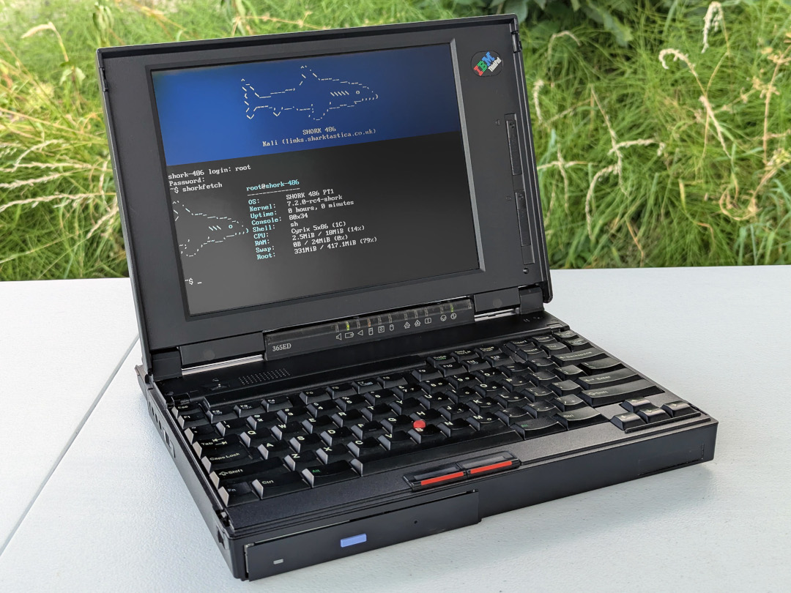
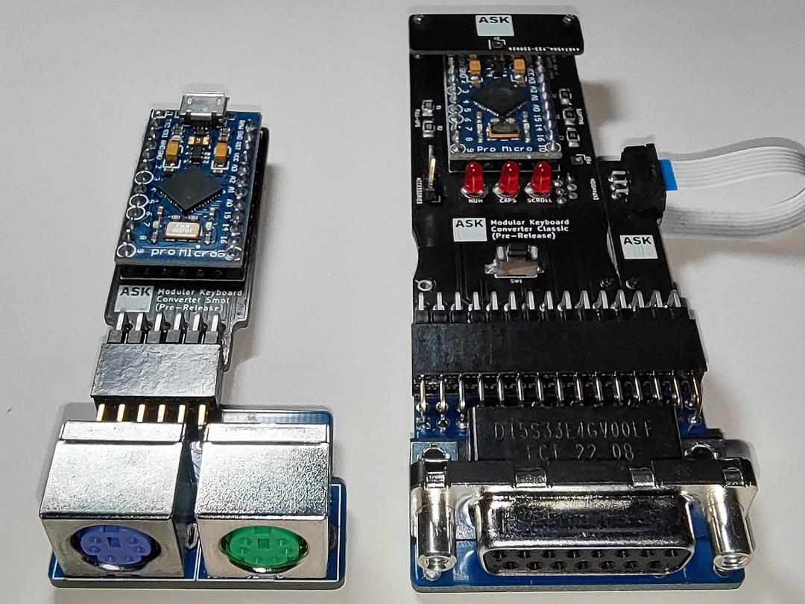

Hi, I'm a full-stack software engineer based in Pontypridd, Wales! My professional background includes computer science/research, geospatial machine learning, virtual and augmented reality, general application and website development, teaching several computer science/game development-related subjects, contributing to papers, and giving conference presentations. I enjoy working with vintage, embedded, kit robots, and other memory-constrained and low-level systems, and participating in game jams.

## Skills

## Education

* MSc by Research Computer Science
* BSc Computer Games Development

## Hobbies & projects

* I'm interested in vintage IBM technology and products like PCs, ThinkPads, terminals, mainframes, typewriters and keypunches. I am the author of [Admiral Shark's Keyboards](https://sharktastica.co.uk/), a website dedicated to IBM keyboards, such as the famous Model M family. On it, I write articles, wikis, and guides to preserve information about them and help others interested in them. I sometimes even exhibit parts of my collection at computer keyboard expos/meetups.

* I am the author of the SHORK family of Linux distributions, designed to run on vintage hardware. [SHORK 486, SHORK 586, SHORK DISC and SHORK DISKETTE](https://github.com/SharktasticA/SHORK-486) are its current members. I write lightweight, efficient tools for them, like [SHORKDIR](https://github.com/SharktasticA/shorkdir) and [SHORKFETCH](https://github.com/SharktasticA/shorkfetch). The aim is to provide more alternative uses for vintage hardware, hopefully keeping them out of landfills for longer, and to see what can possibly be done with old, constrained hardware. Even if it just saves one PC, it's a success for me!

* I designed a modular keyboard converter system that makes it easier to use various old keyboard and mouse designs on modern computers without many bespoke converters for each - one brain, many changeable sockets. The system runs QMK-Vial-based firmware and also serves as a platform to develop new computer peripheral converters.

<table style="table-layout: fixed; width: 100%;">

  <tr>
    <td></td>
    <td></td>
  </tr>
  <tr>
    <td>SHORK 486 Operating System</td>
    <td>Modular Keyboard Converters</td>
  </tr>

</table>
